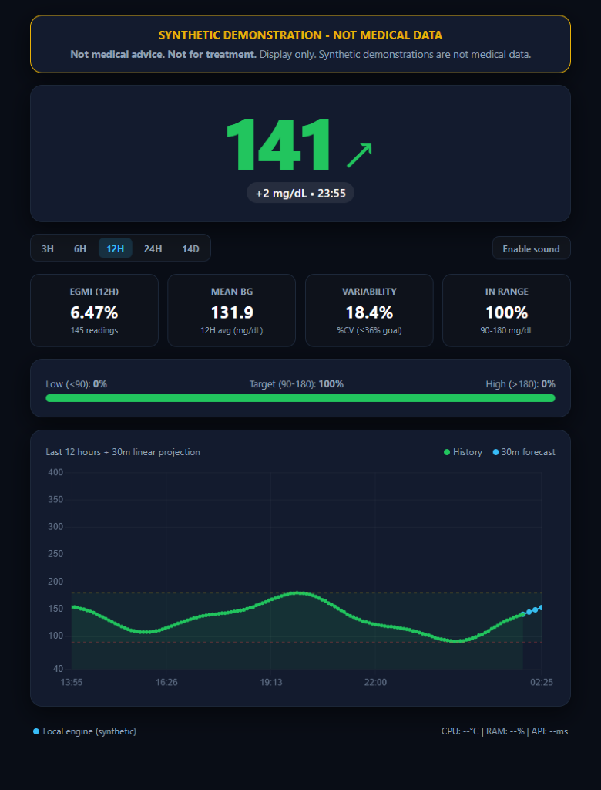
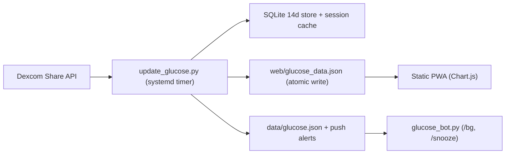

# Glucose Dashboard

[](https://github.com/s3l1a/glucose-dashboard/actions/workflows/ci.yml)

A static dashboard with a Python Dexcom Share updater and an optional Telegram bot. The dashboard displays recent readings, multi-window summary statistics (`3h`, `6h`, `12h`, `24h`, `14d`), a 30-minute linear forecast, stale-data warnings, and local system telemetry.

This project is not medical advice and is not suitable for treatment decisions. Forecasts, estimates, and browser or Telegram alerts are not validated clinical tools.



Live synthetic preview: [https://s3l1a.github.io/glucose-dashboard/](https://s3l1a.github.io/glucose-dashboard/)

## Architecture



## Local Setup

Use Python 3.10 or newer and Node.js 18 or newer for frontend checks.

```sh
python -m venv .venv
# Activate .venv using the command for your shell.
python -m pip install -r requirements.txt
```

## Synthetic Demonstration

```sh
python update_glucose.py --demo
python -m http.server 8000 --bind localhost --directory web
```

Open `http://localhost:8000`. All demonstration readings are generated mathematically with fixed fictional timestamps and labeled **SYNTHETIC DEMONSTRATION - NOT MEDICAL DATA** in the output and dashboard. They are not derived from anyone's medical data. Demo mode does not contact Dexcom and does not sound alarms or send messages. Generated JSON and SQLite files are ignored by Git; no medical records or runtime data are included in this repository.

## Configuration

For private live use, create a local `.env` using `.env.example` as the template, or set environment variables directly. Never commit real values.

| Variable | Purpose |
| --- | --- |
| `DEXCOM_USERNAME` | Required for a live Dexcom update. |
| `DEXCOM_PASSWORD` | Required for a live Dexcom update. |
| `DEXCOM_REGION` | Dexcom region: `us`, `ous`, or `jp`; default `us`. |
| `GLUCOSE_UNIT` | Display unit: `mgdl` (`mg/dL`) or `mmol` (`mmol/L`); default `mgdl`. |
| `LOW_THRESHOLD` | Low threshold in `mg/dL`; default `90` (standard consensus is `70`). |
| `HIGH_THRESHOLD` | High threshold in `mg/dL`; default `180`. |
| `URGENT_LOW_THRESHOLD` | Urgent low push-alert threshold in `mg/dL`; default `70`. |
| `STALE_MINUTES` | Minutes before a reading is marked stale; default `15`. |
| `ALERT_COOLDOWN_MINUTES` | Minimum minutes between repeated push alerts; default `30`. |
| `WEB_DIR` | Dashboard output directory; default `web`. |
| `GLUCOSE_DATA_FILE` | Local reading file shared with the bot; default `data/glucose.json`. |
| `GLUCOSE_DB_FILE` | Local 14-day SQLite store; default `data/history.sqlite3`. |
| `DEXCOM_SESSION_FILE` | Cached Dexcom session token file; default `data/dexcom_session.json`. |
| `ALERT_STATE_FILE` | Cooldown/snooze state file for push alerts; default `data/alert_state.json`. |
| `TELEGRAM_BOT_TOKEN` | Required only for the optional bot and push alerts. |
| `TELEGRAM_ALLOWED_USER_ID` | Required numeric Telegram user ID; other users and group chats are ignored. |

Relative file paths are resolved from this project directory. Demo mode needs no credentials. Run `python update_glucose.py` for one live update, or `python glucose_bot.py` for the optional bot (`/start`, `/bg`, `/snooze [minutes]`). Browser audio requires the enable-sound button and may be blocked by browser policy.

## Metrics and Forecast Notes

- **Time in Range (TIR) & Variability (`%CV`):** Computed across `3h`, `6h`, `12h`, `24h`, and `14d` windows from readings stored locally in SQLite (pruned beyond 14 days). `%CV` is standard deviation divided by mean glucose.
- **GMI / eGMI:** Uses the Bergenstal et al. (2018) formula `3.31 + 0.02392 * mean_mgdl`. Windows shorter than 14 days are labeled `eGMI` in the UI because clinical GMI is defined over 14+ days.
- **30-Minute Forecast:** Ordinary least-squares linear regression over the last 3 to 4 readings within 25 minutes, projected 10, 20, and 30 minutes ahead and clamped to `40-400 mg/dL` (`2.2-22.2 mmol/L`). Suppressed automatically if data is stale or sparse.
- **5-Minute Delta:** Reported only when a prior reading exists within `1-7.5` minutes so dropped packets do not produce misleading deltas.

## Private Deployment

Sample `systemd` service/timer units (`journald` handles log rotation) and a loopback-bound Nginx configuration are provided in [`deploy/`](deploy/).

Do not expose a live dashboard or its JSON on an unauthenticated public server. Bind your local HTTP server to `127.0.0.1` (or your private VPN interface) rather than `0.0.0.0` so LAN neighbors cannot read unauthenticated runtime files. Credentials, runtime readings, logs, keys, backups, caches, and local configuration must remain private. The service worker caches only application shell assets, never reading data. Chart libraries are loaded from the public jsDelivr CDN, so charts require connectivity on first load.

## Checks

```sh
python -m pip install -r requirements-dev.txt
python -m unittest discover -s tests -v
python -m ruff check .
python -m ruff format --check .
python -m compileall -q update_glucose.py glucose_bot.py tests
node checks.mjs
```

The frontend is static and has no bundling step. `checks.mjs` validates JavaScript syntax, manifest, local asset references, viewport accessibility, and safety wording. Tests use only synthetic inputs and do not contact Dexcom or Telegram.

## License

MIT License. See [LICENSE](LICENSE).
